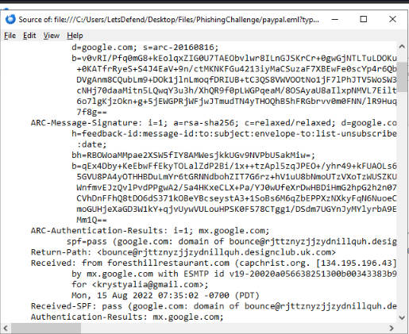

# Lab 01 — Phishing Email

**Platform:** LetsDefend | **Completed:** October 19, 2026 | **Badge:** Phishing Analyzer

## Alert / Scenario
An unexpected German-language message impersonated PayPal and encouraged the recipient to confirm a supposed reward or delivery. This was a controlled email-investigation challenge, not a production SIEM alert.

## Evidence
- The displayed sender name was `P.A.Y.P.A.L` while the visible sender used `kodehexa.net`, unrelated to PayPal.
- The message used a reward/delivery lure and confirmation links.
- Thunderbird's raw message headers showed a Return-Path under `designclub.uk.com`, different from the advertised brand.
- A copied link pointed to `storage.googleapis.com`. Google Cloud Storage is legitimate infrastructure that can also be misused; the hostname alone does not prove maliciousness.

**Method:** Opened the email in Thunderbird, examined raw headers using View → Message Source, and copied the embedded link address for inspection without visiting it.

## Verdict
**Likely phishing via PayPal impersonation.** Branding, sender identity, return-path and link destination are inconsistent. This evidence does **not** establish that any user clicked, submitted credentials, or was compromised.

**Suggested action:** Report and quarantine the particular email, examine the complete URL in an isolated investigation setting, and search for related messages. Do not block all Google Cloud Storage traffic.

## Completion
LetsDefend **Phishing Analyzer** badge earned October 19, 2026. See the evidence folder once screenshots are uploaded.

## Evidence screenshot

This is the raw Thunderbird header view used to inspect the Return-Path and message metadata.
