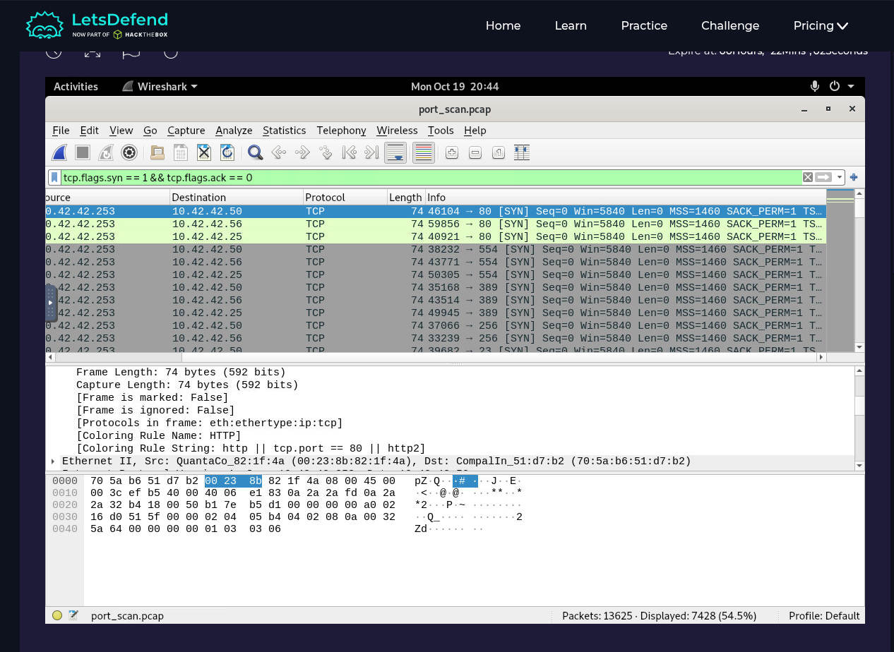

# Lab 02 — Port Scan Activity

**Platform:** LetsDefend | **Completed:** October 19, 2026 | **Badge:** Detector

## Alert / Scenario
The challenge provided a `port_scan.pcap` network capture to determine whether port-scanning behavior occurred and identify systems in the traffic.

## Evidence
In Wireshark, used the display filter:

```wireshark
tcp.flags.syn == 1 && tcp.flags.ack == 0
```

- Repeated initial TCP SYN requests from **`10.42.42.253`** targeted multiple hosts and destination ports.
- Examples of destination hosts: **`10.42.42.50`**, **`10.42.42.56`**, **`10.42.42.25`**.
- The screenshot showed **7,428 displayed packets** of **13,625 total** under this filter. The displayed count alone does not determine intent.
- Additional filter: `smb || smb2 || nbns || ntlmssp` showed NBNS traffic from `10.42.42.50` and `10.42.42.25`. The exercise accepted `10.42.42.50` as the Windows system; NBNS alone cannot reliably establish OS.
- A verified Apple device MAC address was not retained in our available evidence, so none is invented here.


### Additional screenshot evidence (captured in LetsDefend)

In the follow-up Wireshark screenshot, the display filter was `smb || smb2 || nbns || ntlmssp`. The filtered packet list contained **NBNS Name Service** traffic, including:

| Observed field | Value | Why it matters |
| --- | --- | --- |
| Example packet | Frame 6072 | Lets us refer to a specific visible packet |
| Source | `10.42.42.50` | One system issuing NetBIOS queries |
| Additional source | `10.42.42.25` | Another system issuing NetBIOS queries |
| Destination | `10.255.255.255` | Broadcast destination shown in the capture |
| Protocol | NBNS | Name-resolution activity, often seen on Windows networks |
| Query details | `Opcode: Name query`, `Broadcast`, one question | Demonstrates an NBNS broadcast name query |
| Ethernet source on selected packet | `70:5a:b6:51:d7:b2` | Source MAC from this NBNS packet; **not** evidence of an Apple device |

This supports analysis of local name-resolution behavior. It does **not**, by itself, conclusively identify the operating system of either source or show the TCP SYN scan. The earlier SYN-filtered capture is the evidence for port scanning.

*Source: screenshots shared during this LetsDefend investigation. They are not yet uploaded to the GitHub repository; screenshot upload is optional under the provided NEXLEVR requirements.*


## Verdict
**Port scanning observed.** Repeated probes toward different ports and hosts support network reconnaissance. Whether scanning was authorized, or any exploit succeeded, was not established by these excerpts.

**Suggested action:** Correlate source asset ownership and the scan schedule with firewall and endpoint records before escalating.

## Completion
LetsDefend **Detector** badge earned October 19, 2026. The full PCAP is not redistributed.

## Evidence screenshot



Wireshark display filter: `tcp.flags.syn == 1 && tcp.flags.ack == 0`, showing repeated SYN requests targeting different hosts and ports.
